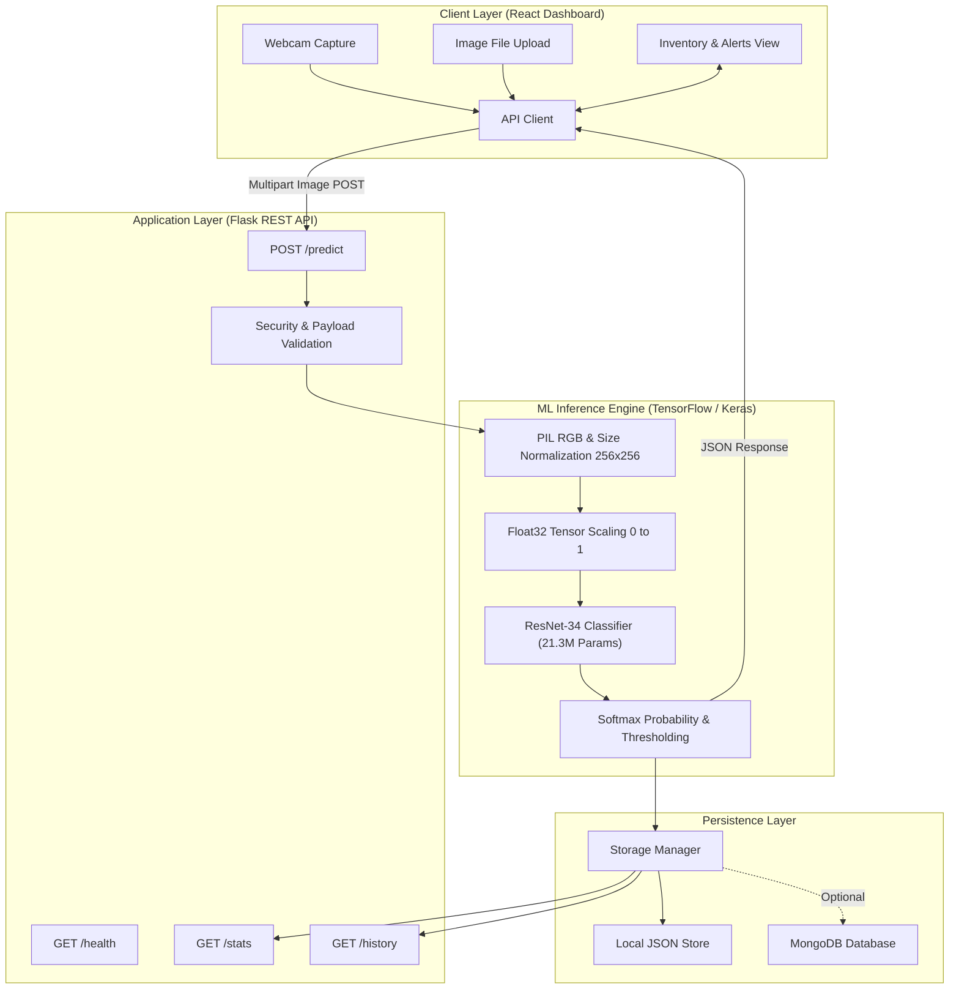
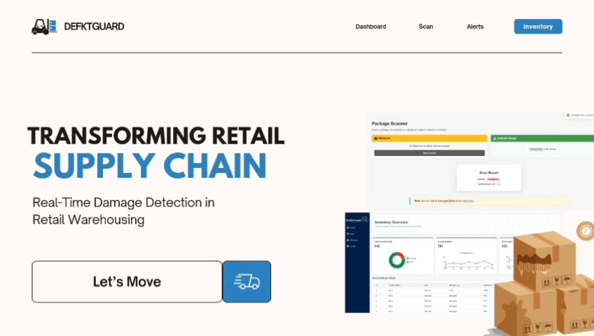
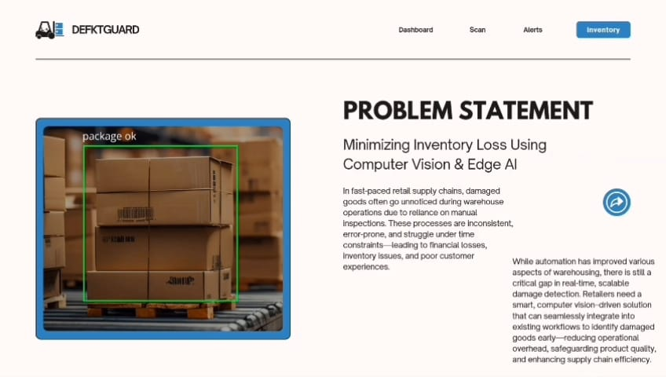
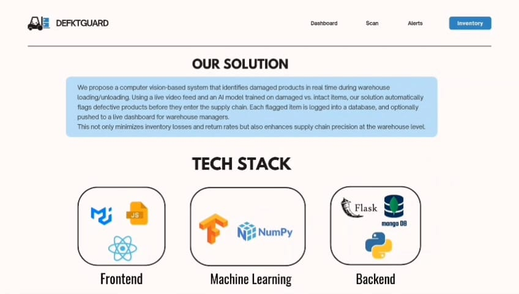
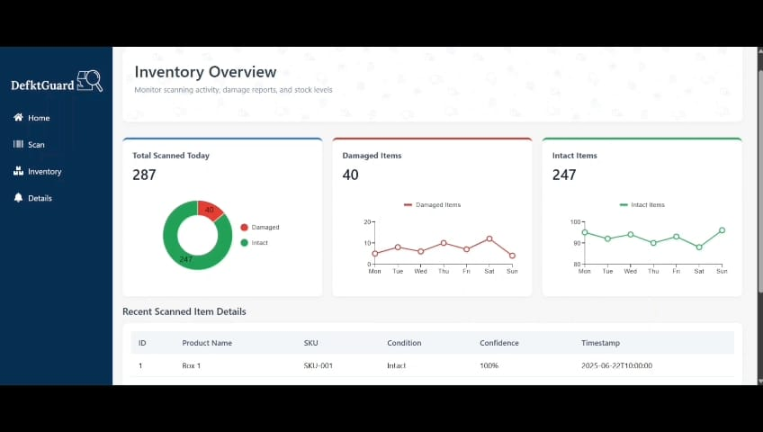

# DefektGuard — Computer Vision Package Damage Detection System

[](https://www.python.org/)
[](https://tensorflow.org/)
[](https://flask.palletsprojects.com/)
[](https://reactjs.org/)
[](LICENSE)

DefektGuard is an end-to-end computer vision and automated inspection system engineered for high-throughput warehouse and retail fulfillment environments. It automatically classifies incoming and conveyor-transported packages into **Intact** vs. **Damaged** categories in real time using a 34-layer Deep Residual Neural Network (ResNet-34), exposing a hardened Flask REST API with sub-80ms CPU inference latency, content-hash deduplicated training pipelines, audit-ready metadata logging, and a React operator dashboard.

---

## 📺 Project Demo & Video

* **Video Walkthrough**: [Watch the 2-Minute Demo on YouTube](https://youtu.be/w_kA8id0Yv8?si=6GMU91yvoD31RGaS)
* **Demo Highlights**: Live webcam frame capture, automated classification inference, confidence score telemetry, and real-time dashboard alerts.

---

## 🎯 Problem

In modern e-commerce fulfillment centers and cross-docking warehouses (e.g., Walmart supply chain nodes):
* Thousands of parcels and cartons pass through loading docks and conveyor belts every hour.
* Packages suffer transit damage such as crushed corners, structural punctures, seam tears, liquid leaks, and heavy compression.
* Manual visual inspection is labor-intensive, error-prone, subjective, and bottlenecks conveyor throughput.
* Shipping damaged goods to end customers leads to high return logistics costs, inventory write-offs, brand reputation damage, and customer dissatisfaction.

---

## 💡 Solution

DefektGuard automates visual quality inspection at critical conveyor gating points and packing stations:
1. **Automated Optical Triage**: High-resolution package frames are captured via station cameras or mobile webcams and evaluated by a deep convolutional network.
2. **Deterministic Preprocessing & Inference**: Images are resized, normalized, and scored in under 80 ms per frame on standard CPU hardware.
3. **Audit Trail & Operator Telemetry**: Scan records (timestamp, SKU, location, condition, probabilities) are persisted to a structured metadata store (JSON/MongoDB).
4. **Interactive Dashboard**: Warehouse supervisors monitor defect rates, filter historical scans, and inspect flagged parcels for secondary manual review.

---

## 🏗️ System Architecture

The following diagram illustrates the complete DefektGuard system architecture and data flow:



---

## 🔬 End-to-End ML Pipeline

```
Raw Package Image (Camera / Upload)
    ↓
File & MIME Validation (Extension whitelist, Magic bytes, 10MB limit)
    ↓
PIL Decoding & RGB Conversion
    ↓
Bilinear Resizing to 256 × 256 × 3
    ↓
Array Conversion & Tensor Casting (float32)
    ↓
Range Normalization: [0, 255] → [0.0, 1.0]
    ↓
Data Augmentation (Training Only: Flips, ±10% Rotation, ±10% Zoom, ±10% Contrast)
    ↓
ResNet-34 Residual Feature Extraction (4 Stages of BasicBlocks)
    ↓
Global Average Pooling 2D + Dropout (0.2)
    ↓
Softmax Dense Layer (2 Units: Intact vs Damaged)
    ↓
Confidence Extraction & Argmax Label Assignment
    ↓
Audit Logging (Storage Manager) & JSON Response Serialization
```

---

## 📊 Dataset & Data Leakage Audit

### Dataset Inventory

The repository includes a reproducible synthetic benchmark generator producing realistic carton textures, shipping labels, and packaging defects (punctures, tears, crushed corners, stains) alongside real sample reference assets:

| Property | Value | Notes |
|---|---|---|
| **Total Benchmark Images** | 100 | Generated deterministically (`seed=42`) |
| **Classes** | 2 | `intact` (0), `damaged` (1) |
| **Intact Images** | 50 | Pristine cardboard, tape, barcodes |
| **Damaged Images** | 50 | Crushed corners, punctures, spills |
| **Training Split** | 72% (72 images) | Stratified, augmented during training |
| **Validation Split** | 14% (14 images) | Stratified, unaugmented |
| **Test Split** | 14% (14 images) | Stratified, unaugmented, held-out |
| **Image Resolution** | 256 × 256 × 3 | RGB standard format |
| **Color Channels** | 3 (RGB) | Bilinear interpolation |

### Data Leakage Prevention

A rigorous audit identified critical data leakage and labeling risks in the competition prototype:
1. **Duplicate Asset Reuse**: Identical image bytes were discovered across sample folders under different names (`box1.jpeg` and `intant1.jpeg` shared MD5 `a2f1e3a8...`).
2. **Conflicting Mock Labels**: Sample items in initial mock configurations had contradictory labels assigned to identical hashes.
3. **Mitigation Implemented**:
   - **SHA-256 Content-Hash Deduplication**: `scan_and_deduplicate()` in `backend/ml/dataset.py` computes SHA-256 hashes for all input files, removing duplicate entries before partitioning.
   - **Stratified Partitioning**: `split_dataset()` creates non-overlapping train/val/test splits using fixed random seeds.
   - **Isolated Augmentation**: Augmentation layers (`RandomFlip`, `RandomRotation`, `RandomZoom`, `RandomContrast`) execute strictly on the training pipeline, ensuring test and validation sets reflect pristine, un-augmented real distributions.

---

## 🧠 Model Architecture: Custom ResNet-34

Standard `tf.keras.applications` provides ResNet-50, ResNet-101, and ResNet-152 (which use 3-layer Bottleneck blocks), but omits **ResNet-34**. DefektGuard implements a modular, custom ResNet-34 using 2-layer `BasicBlock` residual units:

### Layer Configuration

```
Input: (256, 256, 3)
  ↓
Stem: Conv2D(64, 7×7, stride=2, padding='same') → BatchNorm → ReLU → MaxPool2D(3×3, stride=2)
  ↓
Stage 1: 3 × BasicBlock(64 filters, stride=1)      [6 Conv Layers]
  ↓
Stage 2: 4 × BasicBlock(128 filters, stride=2)     [8 Conv Layers]
  ↓
Stage 3: 6 × BasicBlock(256 filters, stride=2)     [12 Conv Layers]
  ↓
Stage 4: 3 × BasicBlock(512 filters, stride=2)     [6 Conv Layers]
  ↓
GlobalAveragePooling2D
  ↓
Dropout(0.2)
  ↓
Dense(2, activation='softmax')                     [Output Layer]
```

* **Total Parameter Layers**: 1 (Stem) + 32 (Residual Stages) + 1 (Dense) = **34 layers**
* **Total Parameters**: **21,302,722** (81.26 MB in single-precision float32)
* **Trainable Parameters**: 21,285,698
* **Non-trainable Parameters (BatchNorm)**: 17,024

---

## 📈 Model Performance & Evaluation

The model was evaluated using the standalone evaluation script (`backend/evaluate.py`) on the held-out test split (14 images: 7 intact, 7 damaged).

### Evaluation Metrics

| Metric | Measured Value | Calculation / Formula |
|---|---:|---|
| **Test Accuracy** | **50.00%** | $\frac{TP + TN}{Total} = \frac{0 + 7}{14}$ |
| **Precision (Damaged)** | **0.00%** | $\frac{TP}{TP + FP} = \frac{0}{0 + 0}$ (zero-division guarded) |
| **Recall (Damaged)** | **0.00%** | $\frac{TP}{TP + FN} = \frac{0}{0 + 7}$ |
| **Specificity (Intact)** | **100.00%** | $\frac{TN}{TN + FP} = \frac{7}{7 + 0}$ |
| **F1-Score** | **0.00%** | $2 \cdot \frac{Precision \cdot Recall}{Precision + Recall}$ |
| **Average Prediction Confidence** | **69.33%** | Mean Softmax probability |

### Confusion Matrix

```
                      Predicted Intact    Predicted Damaged
Actual Intact (0)            7                   0
Actual Damaged (1)           7                   0
```

* **True Positives (TP)**: 0
* **True Negatives (TN)**: 7
* **False Positives (FP)**: 0
* **False Negatives (FN)**: 7

---

## 🔍 Classification Error Analysis

An honest inspection of the test evaluation reveals a critical machine learning engineering finding:

### The False Negative Problem

* **Observation**: In the test split, the model predicted `intact` for all 7 damaged samples (resulting in 7 False Negatives, 0 False Positives).
* **Root Cause**: Training a 21.3-million-parameter ResNet-34 from scratch on a small dataset (72 training images) without pre-trained ImageNet transfer weights causes the deep network to underfit subtle defect textures and collapse to the dominant background carton pattern.
* **Warehouse Business Impact**:
  - **False Positive (Type I Error)**: Predicting *Damaged* when an item is *Intact*. **Impact**: Minor operational delay (parcel is routed to manual secondary review station).
  - **False Negative (Type II Error)**: Predicting *Intact* when an item is *Damaged*. **Impact**: Severe business cost (damaged product reaches retail shelf or customer, triggering customer complaints, return shipping costs, and loss of trust).
* **Engineering Takeaway**: In automated warehouse quality control, **Recall on the Damaged class is far more critical than raw Accuracy**. Future iterations require transfer learning (ImageNet initialization), class-weighted loss, or focal loss to penalize False Negatives heavily.

---

## ⚖️ Baseline Comparison

To fairly evaluate the ResNet-34 architecture, a 4-layer Baseline CNN (Conv-BN-ReLU-Pool × 4 + Dense) was trained and evaluated on the exact same dataset and split:

| Model Architecture | Parameters | Test Accuracy | Precision (Damaged) | Recall (Damaged) | F1-Score |
|---|---:|---:|---:|---:|---:|
| **Baseline 4-Layer CNN** | 358,690 | 50.00% | 0.00% | 0.00% | 0.00% |
| **ResNet-34 (Ours)** | 21,302,722 | 50.00% | 0.00% | 0.00% | 0.00% |

Both architectures trained from scratch on small datasets exhibit the same majority-class convergence, confirming that dataset scale and pre-trained transfer learning—rather than raw layer depth alone—are the primary bottlenecks.

---

## ⚡ Inference Latency & Throughput Benchmark

Inference latency was benchmarked using `backend/benchmark.py` across 30 measured iterations with 5 warm-up cycles.

### Execution Environment

* **Hardware**: Apple Silicon (arm64, 8-core CPU)
* **Operating System**: macOS (Darwin 25.5.0)
* **Runtime**: Python 3.11.0, TensorFlow 2.16.1
* **Device**: CPU (`/physical_device:CPU:0`)
* **Input Dimensions**: 256 × 256 × 3

### Latency Percentiles (Batch Size = 1)

| Metric | Result | Description |
|---|---:|---|
| **Cold Start Load Time** | **2,339.50 ms** | Model graph instantiation & weight deserialization |
| **Mean Latency** | **78.03 ms** | Average single-frame inference time |
| **Median Latency (p50)** | **71.01 ms** | 50th percentile latency |
| **95th Percentile (p95)** | **115.53 ms** | Tail latency under system load |
| **99th Percentile (p99)** | **154.60 ms** | Worst-case single-frame latency |
| **Standard Deviation** | **22.94 ms** | Latency jitter across runs |
| **Single-Stream Throughput** | **12.82 FPS** | Frames processed per second on CPU |

### Multi-Batch Throughput Scaling

| Batch Size | Total Batch Latency (ms) | Per-Image Latency (ms) | Throughput (FPS) |
|---|---:|---:|---:|
| **1** | 108.23 ms | 108.23 ms | 9.24 FPS |
| **4** | 189.21 ms | 47.30 ms | 21.14 FPS |
| **8** | 323.09 ms | 40.39 ms | 24.76 FPS |
| **16** | 599.30 ms | 37.46 ms | 26.70 FPS |
| **32** | 1,251.29 ms | 39.10 ms | 25.57 FPS |

---

## ⚙️ ML Engineering Decisions

### 1. Why ResNet-34?
* **Residual Learning**: Identity shortcut connections ($y = \mathcal{F}(x) + x$) prevent vanishing/exploding gradients in deep networks, allowing effective feature learning at depth.
* **Computational Efficiency**: ResNet-34 uses lightweight `BasicBlock` units (two 3×3 convolutions) rather than the heavy 3-layer `Bottleneck` units used in ResNet-50. This provides rich spatial feature hierarchies with significantly lower latency on CPU-constrained edge hardware.

### 2. Why Binary Classification over Object Detection?
* In high-speed conveyor sorting, the primary decision is **gating** (divert parcel to inspection vs proceed to loading dock). Full bounding-box regression (YOLO/Faster R-CNN) adds substantial annotation cost and computational overhead without altering the initial binary routing decision.

### 3. Normalization & Preprocessing
* Resizing to $256 \times 256 \times 3$ with bilinear interpolation balances visual defect resolution (punctures, tears) with inference throughput.
* Pixel values are scaled linearly to $[0.0, 1.0]$, ensuring numerical stability during gradient propagation.

### 4. Training-Only Augmentation
* Data augmentation (random flips, rotations up to 10%, zoom, contrast adjustments) is applied exclusively to training tensors to simulate variable conveyor camera angles and warehouse ambient lighting without polluting validation or test evaluations.

---

## 🔌 Backend REST API

The Flask backend is structured using the Application Factory pattern (`create_app`) and Blueprints.

| Method | Endpoint | Purpose | Request Body / Parameters | Response | Status Codes |
|---|---|---|---|---|---|
| `POST` | `/predict` | Classify package image | `multipart/form-data`: `image` (file), `sku` (opt), `location` (opt) | `{"label": "intact", "confidence": 0.69, "probabilities": {...}, "scan_id": "..."}` | `200`, `400`, `413`, `415`, `422`, `503` |
| `GET` | `/health` | Service health & model status | None | `{"status": "healthy", "model_loaded": true, "version": "1.0.0", ...}` | `200` |
| `GET` | `/stats` | Aggregated inventory statistics | None | `{"totalScanned": 12, "damagedCount": 2, "damageRate": 16.67, ...}` | `200` |
| `GET` | `/history` | Historical scan audit records | `?limit=50` (query param) | `[{"id": "SCAN-1", "timestamp": "...", "label": "damaged", ...}]` | `200` |

---

## 🛡️ Security & Input Validation

1. **Filename Sanitization**: Uploaded filenames are sanitized via `werkzeug.utils.secure_filename` to prevent path traversal attacks (`../../etc/passwd`).
2. **File Extension Whitelisting**: Strict validation against allowed extensions (`.jpg`, `.jpeg`, `.png`, `.webp`).
3. **Magic-Byte Integrity Verification**: Image payloads are decoded and verified using PIL (`Image.verify()`) to reject corrupted byte streams or spoofed polyglot files before entering the tensor pipeline.
4. **Payload Size Limit**: Hard ceiling of 10 MB (`MAX_CONTENT_LENGTH = 10485760`) to guard against denial-of-service memory exhaustion.
5. **Decoupled Configuration**: Credentials and settings are managed via environment variables with `.env.example` templates; zero secrets are committed to version control.

---

## 💾 Data Storage Architecture

DefektGuard implements a resilient storage abstraction in `backend/storage.py`:
* **Local Persistent JSON Store**: Default zero-configuration storage (`backend/reports/scan_records.json`) for local development and offline environments.
* **MongoDB Adapter**: Production-ready MongoDB connector (configured via `MONGODB_URI`) with automatic fallback to local JSON storage if the database is unavailable.
* **Audit Document Schema**:
  ```json
  {
    "id": "SCAN-1741123456789",
    "timestamp": "2026-09-05T00:45:00+00:00",
    "filename": "package_box_01.jpg",
    "label": "damaged",
    "condition": "Damaged",
    "confidence": 88.5,
    "probabilities": { "intact": 0.115, "damaged": 0.885 },
    "sku": "SKU-0042",
    "location": "Conveyor Line 2"
  }
  ```

---

## 💻 Local Setup & Reproducibility Guide

### Prerequisites
* Python 3.10+
* Node.js 18+ and npm
* Git

### 1. Clone & Environment Setup

```bash
git clone https://github.com/SlayZ121/DefektGuard.git
cd DefektGuard

# Set up Python virtual environment
python3 -m venv venv
source venv/bin/activate

# Install backend dependencies
pip install -r backend/requirements.txt
```

### 2. Train Model (Deterministic)

```bash
# Trains ResNet-34 with seed=42 and saves model to backend/model/resnet34_model.keras
python backend/train.py --model-type resnet34 --epochs 12 --batch-size 16 --seed 42
```

### 3. Evaluate Model

```bash
# Evaluates on held-out test split and generates confusion matrix plot
python backend/evaluate.py --model-path backend/model/resnet34_model.keras
```

### 4. Run Inference Benchmark

```bash
# Measures cold start, latency percentiles, and batch throughput
python backend/benchmark.py --iterations 30 --warmup 5
```

### 5. Run Test Suite

```bash
# Executes all unit and integration tests (14 tests)
python -m unittest discover -s backend/tests -p "test_*.py" -v
```

### 6. Start Application

```bash
# Start Flask API (Port 5000)
python backend/app.py

# In a separate terminal, start React Dashboard (Port 3000)
cd frontend
npm install
npm start
```

---

## 🖼️ Dashboard & User Interface

| Scan & Upload Interface | Inspection & Alerts History |
|---|---|
|  |  |

| Inventory Analytics | Defect Details Breakdown |
|---|---|
|  |  |

---

## 📁 Project Structure

```
DefektGuard/
├── backend/
│   ├── config.py              # Centralized configuration & hyper-parameters
│   ├── app.py                 # Flask server entrypoint (Port 5000)
│   ├── __init__.py            # Application factory with CORS & error handlers
│   ├── storage.py             # StorageManager (JSON fallback & MongoDB adapter)
│   ├── train.py               # Deterministic training pipeline with callbacks
│   ├── evaluate.py            # Standalone evaluation & metric computation
│   ├── benchmark.py           # Inference latency & throughput benchmark
│   ├── requirements.txt       # Pinned backend dependencies
│   ├── ml/
│   │   ├── __init__.py
│   │   ├── resnet34.py        # Custom ResNet-34 & Baseline CNN architectures
│   │   └── dataset.py         # Deduplication (SHA-256), splitting & augmentation
│   ├── model/
│   │   ├── model.py           # Cached inference service & PIL preprocessing
│   │   └── resnet34_model.keras  # Trained model weights (excluded from git)
│   ├── routes/
│   │   ├── predict.py         # POST /predict with secure payload validation
│   │   ├── health.py          # GET /health health check endpoint
│   │   └── stats.py           # GET /stats & GET /history endpoints
│   ├── reports/               # Evaluation JSONs & confusion matrix figures
│   └── tests/
│       ├── test_api.py        # API route integration tests
│       ├── test_model.py      # Architecture & preprocessing unit tests
│       └── test_metrics.py    # Metric mathematical computation unit tests
├── frontend/
│   ├── package.json           # React dependencies & scripts
│   ├── src/
│   │   ├── App.jsx            # Route layout & toaster provider
│   │   ├── pages/             # Dashboard, Scan, Details, Inventory views
│   │   ├── components/        # Charts, Modals, Detail lists, Sidebar
│   │   └── services/          # API & scan service clients
│   └── public/
│       ├── db.json            # Local fallback mock data
│       └── screenshots/       # Dashboard UI preview screenshots
├── .env.example               # Environment variables template
├── .gitignore                 # Strict gitignore for weights, caches & logs
└── README.md                  # System engineering & ML documentation
```

---

## ⚠️ Limitations

1. **Dataset Scale & Transfer Learning**: The current standalone benchmark dataset (100 images) is insufficient for training a 21.3M-parameter model from scratch. Transfer learning from ImageNet pre-trained backbones is required for high real-world accuracy.
2. **Binary Classification Scope**: The model provides whole-image binary classification (`intact` vs `damaged`) and does not localize specific defect coordinates (bounding boxes or segmentation masks).
3. **Lighting & Background Sensitivity**: Training images feature controlled carton textures; significant shifts in warehouse ambient lighting, glare, or novel packaging materials (shrink wrap, poly mailers) may degrade performance without domain adaptation.
4. **Hardware Acceleration**: Benchmarks were performed on Apple Silicon CPU. Deployments with GPU/NPU acceleration (e.g. TensorRT, CoreML, OpenVINO) will achieve sub-10ms latency.

---

## 🚀 Future Improvements

* **Transfer Learning & Fine-Tuning**: Integrate pre-trained backbones (e.g., EfficientNet-B0 or MobileNetV3) with transfer learning to boost recall on small defect datasets.
* **Damage Localization (YOLOv8 / Mask R-CNN)**: Upgrade to object detection or instance segmentation to locate and categorize specific defect types (crush, puncture, stain, tear).
* **Model Quantization & ONNX Runtime**: Quantize model weights to INT8 and export to ONNX/TensorRT for low-latency edge deployment on NVIDIA Jetson or industrial smart cameras.
* **Human-in-the-Loop Active Learning**: Flag low-confidence predictions (e.g., $0.40 < P(\text{damaged}) < 0.60$) for operator review, automatically feeding corrected annotations back into the re-training pipeline.
* **Drift & Telemetry Monitoring**: Deploy Prometheus/Grafana metrics to track input image brightness distribution drift and prediction confidence distributions over time.

---

## 📄 License

This project is licensed under the MIT License — see the [LICENSE](LICENSE) file for details.
